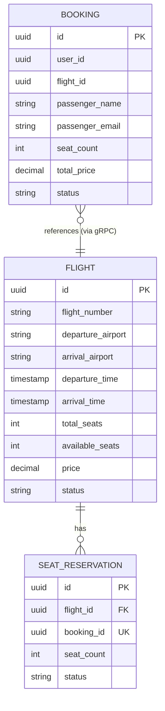

# Homework 3: Микросервисная архитектура бронирования авиабилетов

## Описание

Проект реализует систему бронирования авиабилетов на основе микросервисной архитектуры. 
Система состоит из двух независимых сервисов - **Flight Service** (управление рейсами) 
и **Booking Service** (управление бронированиями), взаимодействующих через gRPC.

Архитектурные решения опираются на принципы из курса:
- **Независимое развёртывание** сервисов
- **Ответственность за своё состояние** (у каждого сервиса своя БД)
- **Слабая связанность** через чётко определённые контракты (protobuf)
- **Отказоустойчивость** через паттерны Retry и Circuit Breaker

---

### Компоненты инфраструктуры

| Компонент | Назначение |
|-----------|-----------|
| **PostgreSQL (*2)** | Изолированные БД для каждого сервиса |
| **Flyway** | Версионирование и миграции схем БД |
| **Redis Master** | Основное хранилище кэша |
| **Redis Replica** | Реплика для отказоустойчивости |
| **Redis Sentinel** | Мониторинг и автоматическое переключение master/replica |

---

## Стек технологий

- **Язык**: Python 3.11
- **Booking Service**: FastAPI + Uvicorn (REST API, OpenAPI/Swagger)
- **Flight Service**: gRPC (синхронный сервер)
- **ORM**: SQLAlchemy 2.0
- **Кэш**: redis-py с поддержкой Sentinel
- **Миграции**: Flyway 9
- **Контейнеризация**: Docker + Docker Compose
- **Retry**: tenacity (exponential backoff)
- **Circuit Breaker**: кастомный gRPC interceptor

---

## Реализованные требования

### Блок 1-4: Базовая реализация

| № | Требование | Реализация |
|---|-----------|-----------|
| 1 | gRPC-контракт для Flight Service | `proto/flight.proto` с 4 методами: `SearchFlights`, `GetFlight`, `ReserveSeats`, `ReleaseReservation` |
| 2 | ER-диаграмма и нормализация | См. раздел "ER-диаграмма" ниже. Таблицы в 3NF |
| 3 | SQL-скрипты создания таблиц | `flight-service/migrations/V1__init.sql`, `booking-service/migrations/V1__init.sql` |
| 4 | Реализация Flight Service на Python | `flight-service/app/flight_servicer.py` |

### Блок 5-7: Надёжность и кэширование

| № | Требование | Реализация |
|---|-----------|-----------|
| 5 | Транзакционная целостность | `SELECT ... FOR UPDATE` в `ReserveSeats` и `ReleaseReservation` (блокировка строки рейса) |
| 6 | Аутентификация межсервисных вызовов | gRPC interceptor проверяет `x-api-key` в metadata. При отсутствии/невалидности -> `UNAUTHENTICATED` |
| 7 | Redis кэш (Cache-Aside) | Кэширование результатов `SearchFlights` и `GetFlight`. Инвалидация при изменении данных. Логи `CACHE HIT/MISS/SET/INVALIDATED` |

### Блок 8-10: Отказоустойчивость

| № | Требование | Реализация |
|---|-----------|-----------|
| 8 | Retry с exponential backoff | `tenacity`: макс. 3 попытки, задержки 100мс -> 200мс -> 400мс. Только для `UNAVAILABLE` / `DEADLINE_EXCEEDED` |
| 9 | Redis Sentinel кластер | Master + Replica + Sentinel. Подключение через `Sentinel` клиент с резолвингом hostname |
| 10 | Circuit Breaker | Состояния `CLOSED -> OPEN -> HALF_OPEN`. Порог сбоев и время восстановления - из env. При OPEN -> HTTP 503 |

---

## Структура проекта

```
homework-3/
├── docker-compose.yml          # Оркестрация всех сервисов
├── .env                        # Переменные окружения
├── proto/
│   └── flight.proto            # gRPC-контракт
├── flight-service/
│   ├── Dockerfile
│   ├── requirements.txt
│   ├── main.py                 # Точка входа gRPC-сервера
│   ├── migrations/
│   │   └── V1__init.sql        # Миграция Flight Service БД
│   └── app/
│       ├── __init__.py
│       ├── config.py           # Настройки из env
│       ├── database.py         # SQLAlchemy модели
│       ├── cache.py            # Redis Sentinel клиент
│       ├── auth_interceptor.py # gRPC interceptor аутентификации
│       ├── flight_servicer.py  # Бизнес-логика Flight Service
│       ├── flight_pb2.py       # Сгенерированный protobuf код
│       └── flight_pb2_grpc.py
├── booking-service/
│   ├── Dockerfile
│   ├── requirements.txt
│   ├── main.py                 # Точка входа FastAPI
│   ├── migrations/
│   │   └── V1__init.sql        # Миграция Booking Service БД
│   └── app/
│       ├── __init__.py
│       ├── config.py
│       ├── schemas.py          # Pydantic модели
│       ├── grpc_client.py      # gRPC клиент с retry-обёртками
│       ├── interceptors.py     # Circuit Breaker interceptor
│       ├── routers/
│       │   ├── flights.py      # REST endpoints для рейсов
│       │   └── bookings.py     # REST endpoints для бронирований
│       ├── flight_pb2.py
│       └── flight_pb2_grpc.py
└── redis/                      # Конфигурация Redis Sentinel        
```

---

## Запуск

Все сервисы поднимаются одной командой:

```bash
docker-compose up -d --build
```

После запуска:
- **Booking Service (REST API)**: http://localhost:8001
- **Swagger UI**: http://localhost:8001/docs
- **Flight Service (gRPC)**: localhost:50051
- **PostgreSQL Booking**: localhost:5433
- **PostgreSQL Flight**: localhost:5434
- **Redis Sentinel**: localhost:26379

### Остановка

```bash
docker-compose down -v   # -v удаляет volumes (БД), иногда нужно
```

---

## API документация

После запуска можно открыть http://localhost:8001/docs - интерактивная Swagger-документация.

### Основные endpoints

| Метод | Путь | Описание |
|-------|------|----------|
| `GET` | `/flights` | Поиск рейсов (query: `origin`, `destination`, `date`) |
| `GET` | `/flights/{flight_id}` | Получить рейс по ID |
| `POST` | `/bookings` | Создать бронирование |
| `GET` | `/bookings` | Список бронирований пользователя (query: `user_id`) |
| `GET` | `/bookings/{booking_id}` | Получить бронирование по ID |
| `POST` | `/bookings/{booking_id}/cancel` | Отменить бронирование |
| `GET` | `/health` | Health check |

### Коды ответов

| Код | Ситуация |
|-----|----------|
| `200` | Успех |
| `201` | Бронирование создано |
| `400` | Недостаточно мест / некорректные данные |
| `404` | Рейс или бронирование не найдено |
| `500` | Внутренняя ошибка (gRPC сбой после retry) |
| `503` | Circuit Breaker OPEN (Flight Service недоступен) |

---

## ER-диаграмма



P.S. Связь между `BOOKING` и `FLIGHT` - логическая (через gRPC), а не через FK, так как у каждого сервиса своя БД.

---

## Тестирование

### Проверка аутентификации gRPC

```bash
cd booking-service
PYTHONPATH=./app python3 test_auth.py
```

Ожидаемый результат:
- Запрос без ключа -> `UNAUTHENTICATED`
- Запрос с неверным ключом -> `UNAUTHENTICATED`
- Запрос с правильным ключом -> успех

### Проверка Circuit Breaker

1. Остановить Flight Service: `docker-compose stop flight-service`
2. Сделать 3 запроса -> получат 500 (retry исчерпан)
3. 4-й запрос -> мгновенно вернёт **503** (Circuit Breaker OPEN)
4. Запустить Flight Service: `docker-compose start flight-service`
5. Подождать 10 секунд -> следующий запрос пройдёт, CB вернётся в CLOSED

### Проверка кэша

В логах Flight Service при повторных запросах:
```
CACHE MISS: search:SVO:LED:2026-04-01
CACHE SET: search:SVO:LED:2026-04-01 (TTL: 300s)
CACHE HIT: search:SVO:LED:2026-04-01
```

---

## Безопасность

- **Аутентификация gRPC**: API Key передаётся в metadata (`x-api-key`)
- **Ключ хранится в env**: переменная `GRPC_AUTH_KEY` в `.env`
- **Изоляция БД**: каждый сервис имеет свою БД и учётные данные
- **Нет общих секретов между сервисами**: только через env