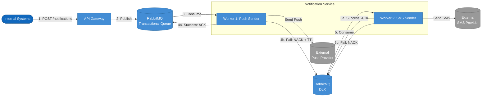
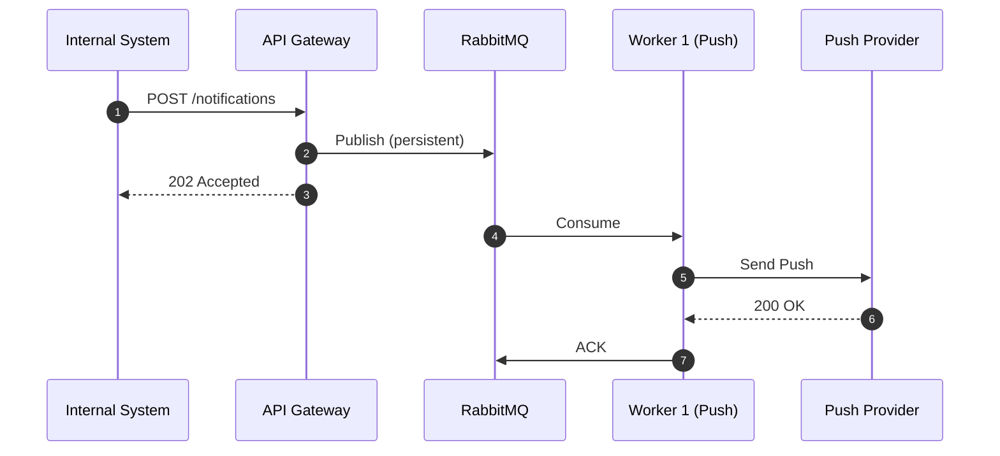
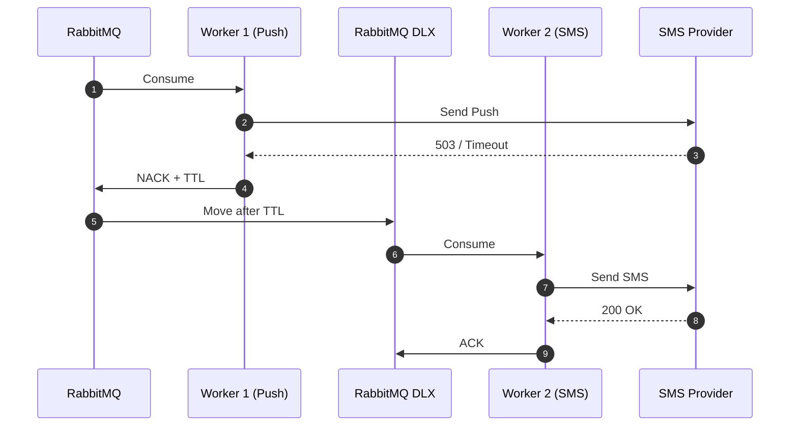
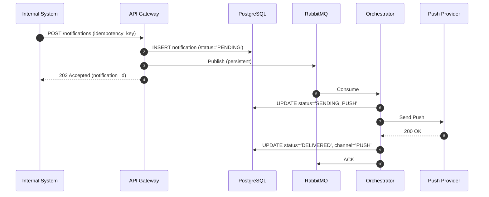
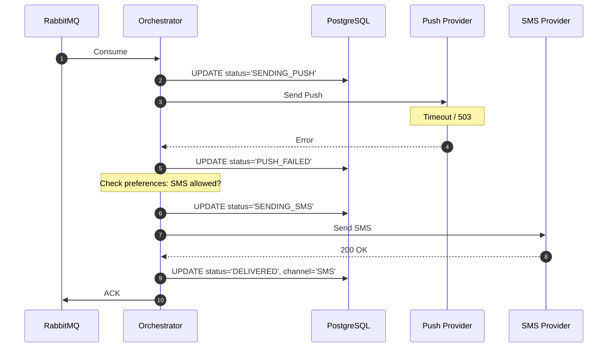

# RFC: Проектирование механизма гарантированной доставки критических (транзакционных) уведомлений с автоматическим failover между каналами доставки

| Метаданные | Значение |
|---|---|
| Статус | DRAFT |
| Автор(ы) | Кузнецов Игорь |
| Ответственный | Кузнецов Игорь |
| Бизнес-заказчик | Product Owner Notification Platform |
| Ревьюеры | Кузнецов Игорь, 10.11.2026 |
| Дата создания | 10.11.2026 |
| Дата обновления | 10.11.2026 |

## Оглавление

- [Контекст](#контекст)
- [Продуктовый анализ](#продуктовый-анализ)
- [Пользовательские сценарии](#пользовательские-сценарии)
- [Статистика](#статистика)
- [Требования](#требования)
- [Варианты решения](#варианты-решения)
- [Сравнительный анализ](#сравнительный-анализ)
- [Выводы](#выводы)
- [Связанные задачи](#связанные-задачи)
- [Приложения](#приложения)

---

## Контекст

**Текущая ситуация:** В онлайн-банке уведомления генерируются децентрализованно разными командами (транзакции, маркетинг, поддержка). Каждый сервис использует собственные подходы к доставке, что приводит к дублированию сообщений, задержкам, отсутствию гарантий доставки критичных событий и росту жалоб пользователей.

**Проблема:** Недоставка транзакционных уведомлений (подтверждение перевода, списание средств) напрямую влияет на пользовательский опыт и безопасность. Внешние провайдеры (Push/SMS/email) работают нестабильно, массовые кампании создают всплески нагрузки, а пользователь не может гибко управлять каналами получения.

**Решение:** Спроектировать в рамках Notification Platform подсистему гарантированной доставки транзакционных уведомлений с автоматическим кросс-канальным failover, которая:
- гарантирует доставку хотя бы через один канал;
- автоматически переключается на резервный канал при отказе основного;
- учитывает пользовательские настройки;
- минимизирует стоимость доставки;
- обеспечивает observability процесса;
- предотвращает дублирование при failover.

### Ключевые вопросы

| Вопрос | Ответ |
|---|---|
| Какую проблему мы решаем? | Недоставку и дублирование транзакционных уведомлений, отсутствие гарантий SLA. |
| Почему это важно сейчас? | Рост базы до 10 млн MAU, регуляторные требования к доставке финансовых уведомлений, прямое влияние на retention и жалобы. |
| Кто затронут этим изменением? | Пользователи банка (получатели), внутренние сервисы-источники (отправители), служба поддержки (аудит), маркетинг (изоляция нагрузки). |

---

## Продуктовый анализ

Бизнес-цели, из которых выводятся требования:

| Метрика | Текущее значение | Целевое значение | Источник НФТ |
|---|---|---|---|
| Retention пользователей | базовый | **+15%** | Релевантность, отсутствие спама, уважение предпочтений |
| Жалобы на уведомления | базовый | **−30%** | Отсутствие дублирования, контроль частоты |
| Доставка критичных событий | без SLA | **≥ 99.9% за 5 мин** | Надёжность, observability |

---

## Пользовательские сценарии

| Приоритет | Тип сценария | Действующее лицо | Сценарий |
|---|---|---|---|
| MUST HAVE | Транзакционный | Система транзакций | Отправляет событие о переводе; система гарантирует доставку через Push, при сбое - через SMS в течение 5 минут. |
| MUST HAVE | Управление предпочтениями | Пользователь банка | Настраивает каналы и категории уведомлений. Транзакционные отключить нельзя (регуляторика), маркетинговые - можно. |
| MUST HAVE | Failover | Система уведомлений | При недоставке Push за 30 сек автоматически эскалирует в SMS с учётом предпочтений и лимитов. |
| SHOULD HAVE | Массовая рассылка | Маркетинговая система | Ставит в очередь кампанию на 1 млн пользователей; рассылка идёт фоново, не влияя на latency транзакционных. |
| SHOULD HAVE | Аудит | Администратор / поддержка | Ищет уведомление по `user_id` или `correlation_id`, видит полный путь: queued → sent → delivered/failed. |
| COULD HAVE | Аналитика каналов | Product Owner | Видит дашборд с delivery rate, error rate, latency percentiles по каждому каналу и провайдеру. |

---

## Статистика

### Входные данные

- **MAU:** 10 000 000 пользователей
- **DAU:** 3 000 000 пользователей
- **Peak Concurrent Users:** 300 000
- **Среднее уведомлений на пользователя в день:** транзакционные - 2, сервисные - 3, маркетинговые - 5 (итого ~10)

### Расчёт пиковой нагрузки (RPS)

Принимаем, что пиковая активность (утренние часы, зарплатный день) концентрирует **20% суточной нагрузки в один час** (3600 сек).

| Тип уведомлений | Событий/день | Пик (20% за час) | RPS |
|---|---|---|---|
| Транзакционные | 3M x 2 = 6M | 1.2M | **~= 333 RPS** |
| Сервисные | 3M x 3 = 9M | 1.8M | **~= 500 RPS** |
| Маркетинговые (пик кампании) | до 1M за кампанию | 1M / 3600 | **~= 278 RPS** |
| **Итого пик на входе API** | - | - | **~= 1100 RPS** |

**Вывод:** Умеренная нагрузка, выдерживается кластером из 2-3 инстансов Python/FastAPI при асинхронной обработке внешних вызовов.

### Расчёт хранилища (Capacity)

- Записей в месяц: 3M DAU x 4 события x 30 дней = **360 000 000 записей**
- Размер записи (payload, статусы, timestamps, trace_id): ~1.5 KB
- Объём в месяц: 360M x 1.5 KB ~= **540 GB/месяц**

**Вывод:** Единая таблица PostgreSQL без партицирования деградирует. Необходимо **партицирование по дате** (месяц) и TTL-политика: детализированные логи старше 90 дней архивируются в S3.

---

## Требования

### Функциональные требования

| № | Приоритет | Обозначение | Требование |
|---|---|---|---|
| 1 | MUST HAVE | FR-1 | Система принимает события от внутренних сервисов через REST API и гарантирует их постановку в очередь. |
| 2 | MUST HAVE | FR-2 | Транзакционные уведомления доставляются через основной канал (Push); при недоставке в течение SLA - автоматически эскалируются в резервный (SMS). |
| 3 | MUST HAVE | FR-3 | Пользователь может управлять предпочтениями: отключать маркетинговые и часть сервисных уведомлений, но не транзакционные. |
| 4 | SHOULD HAVE | FR-4 | Маркетинговые кампании ставятся в отдельную очередь с rate limiting и не влияют на latency транзакционных. |
| 5 | SHOULD HAVE | FR-5 | Администратор может получить статус любого уведомления по `user_id` / `correlation_id` с полной историей переходов состояний. |

### Нефункциональные требования

| № | Приоритет | Обозначение | Требование | Метрика |
|---|---|---|---|---|
| 1 | MUST HAVE | NFR-1 | Низкая задержка приёма события до публикации в брокере | P95 ≤ 150 мс, P99 ≤ 200 мс |
| 2 | MUST HAVE | NFR-2 | Гарантия доставки транзакционных уведомлений | ≥ 99.9% доставок в течение 5 минут |
| 3 | MUST HAVE | NFR-3 | Изоляция нагрузки транзакционных и маркетинговых уведомлений | Маркетинговый пик 10k RPS не деградирует P95 транзакционных (≤ 150 мс) |
| 4 | MUST HAVE | NFR-4 | Доступность API приёма событий | SLA 99.95% (~4.3 ч простоя/год) |
| 5 | MUST HAVE | NFR-5 | Наблюдаемость процесса доставки | 100% событий имеют `correlation_id`; статусы логируются в БД и экспортируются в Prometheus |

### Архитектурно значимые требования (ASR)

| ASR | Связанные требования | Почему влияет на архитектуру |
|---|---|---|
| **ASR-1:** Гарантия доставки критичных уведомлений | NFR-2, FR-2 | Требует persistent messages, manual ACK, DLQ, retry с exponential backoff, идемпотентности. Исключает fire-and-forget. |
| **ASR-2:** Изоляция нагрузки типов уведомлений | NFR-3, FR-4 | Требует раздельных приоритетных очередей, отдельных consumer groups, rate limiting для маркетинга. |
| **ASR-3:** Наблюдаемость процесса доставки | NFR-5, FR-5 | Требует сквозного `correlation_id`, структурированного логирования, хранения истории состояний в БД, метрик по каналам. |

---

## Варианты решения

### Вариант 1: Stateless Worker с RabbitMQ DLX ("Умный брокер")

**Описание:** Логика failover делегирована брокеру. Worker 1 читает из `notifications.transactional`, пытается отправить Push. При ошибке - NACK с TTL, сообщение попадает в Dead Letter Exchange. Worker 2 читает из DLX и пытается отправить SMS. Состояние доставки не сохраняется нигде, кроме заголовков сообщения в брокере.

#### Архитектура



**Sequence: основной сценарий (Push OK)**


**Sequence: failover (Push fail → SMS)**


#### Этапы реализации

| Этап | Описание | Планируемый срок | Ресурсы | Риски |
|---|---|---|---|---|
| 1 | Настройка RabbitMQ: очереди, DLX, TTL, приоритеты | 1 неделя | 1 DevOps | Неправильный TTL → задержка failover |
| 2 | Реализация Worker 1 (Push) и Worker 2 (SMS) | 2 недели | 2 Backend | Риск дублирования при повторной доставке |
| 3 | Интеграция с провайдерами, retry-политики | 1 неделя | 2 Backend | Нестабильность провайдеров |
| 4 | Мониторинг и алерты | 1 неделя | 1 DevOps + 1 Backend | Сложность парсинга логов брокера |

#### Преимущества
- Минимальное количество компонентов (нет БД для состояния).
- Низкая задержка на этапе приёма (только публикация в RabbitMQ).
- Быстрый старт реализации.

#### Недостатки
- **Нарушение ASR-3 (Наблюдаемость):** невозможно легко ответить на вопрос "доставлено ли уведомление пользователю X вчера?" без парсинга логов брокера.
- **Риск дублирования:** при падении Worker после отправки SMS, но до ACK - сообщение будет доставлено повторно. Идемпотентность без БД крайне сложна.
- **Сложность маршрутизации:** DLX плохо подходит для бизнес-логики ("если Push не доставлен, но пользователь отключил SMS - ничего не делать").

---

### Вариант 2: Stateful Orchestrator ("Оркестратор состояний")

**Описание:** Orchestrator (Python/FastAPI) выступает координатором бизнес-процесса (Saga Orchestrator pattern). При получении события **сначала** создаёт запись в PostgreSQL со статусом `PENDING` и уникальным `idempotency_key`. Затем пытается отправить Push. При успехе - статус `DELIVERED`. При ошибке/таймауте - статус `PUSH_FAILED`, инициируется отправка через SMS. RabbitMQ используется как надёжная шина для асинхронной буферизации и изоляции нагрузки, а не как машина состояний.

#### Архитектура

```mermaid
flowchart TD
    Client([Internal Systems])
    API[API Gateway]
    DB[(PostgreSQL\nNotifications &\nPreferences)]
    MQ[(RabbitMQ\nPriority Queues)]
    Orch[Orchestrator Worker\nPython / FastAPI]
    PushProv[(External\nPush Provider)]
    SMSProv[(External\nSMS Provider)]

    Client -->|1. POST /notifications| API
    API -->|2. INSERT PENDING| DB
    API -->|3. Publish Task| MQ
    API -->> Client: 202 Accepted
    MQ -->|4. Consume| Orch
    Orch -->|5a. UPDATE DELIVERED| DB
    Orch -->|5b. UPDATE PUSH_FAILED| DB
    Orch -.->|6. Send Push| PushProv
    Orch -.->|7. Send SMS| SMSProv

    classDef system fill:#1168bd,stroke:#0b4884,color:#fff
    classDef container fill:#438dd5,stroke:#2c6aa0,color:#fff
    classDef db fill:#08427b,stroke:#052e56,color:#fff
    classDef ext fill:#999999,stroke:#666666,color:#fff
    
    class Client system
    class API,MQ,Orch container
    class DB db
    class PushProv,SMSProv ext
```

**Sequence: основной сценарий (Push OK)**


**Sequence: failover (Push fail → SMS success)**


#### Этапы реализации

| Этап | Описание | Планируемый срок | Ресурсы | Риски |
|---|---|---|---|---|
| 1 | Проектирование схемы БД: таблицы `notifications`, `delivery_log`, `preferences`; партицирование | 1 неделя | 1 Backend + 1 DBA | Неправильный выбор ключа партицирования |
| 2 | Реализация API Gateway + INSERT в БД + публикация в RabbitMQ | 1 неделя | 2 Backend | Задержка INSERT влияет на latency API |
| 3 | Реализация Orchestrator: конечный автомат состояний, retry с exponential backoff, circuit breaker | 2 недели | 2 Backend | Сложность обработки race conditions |
| 4 | Интеграция с провайдерами Push/SMS/email, проверка предпочтений | 1 неделя | 2 Backend | Нестабильность провайдеров |
| 5 | Observability: correlation_id, Prometheus-метрики, Grafana-дашборды | 1 неделя | 1 Backend + 1 DevOps | Объём метрик при 360M записей/мес |
| 6 | Load testing и tuning | 1 неделя | 2 Backend + 1 QA | Выявление bottleneck под нагрузкой |

#### Преимущества
- **Полная наблюдаемость (ASR-3):** история всех переходов состояния в PostgreSQL, доступна через REST API.
- **Идемпотентность:** повторная обработка того же сообщения из RabbitMQ не приводит к дублированию благодаря unique constraint по `idempotency_key`.
- **Гибкость:** легко добавить новые каналы или правила ("не слать SMS после 23:00") без перенастройки брокера.
- **Соответствие принципам микросервисов:** явное управление состоянием бизнес-процесса (Saga Orchestrator), изоляция домена уведомлений.

#### Недостатки
- Дополнительная нагрузка на PostgreSQL (~540 GB/мес) - решается партицированием и TTL.
- Чуть выше latency на этапе приёма (+10-20 мс на INSERT) - остаётся в рамках NFR-1 (P95 ≤ 150 мс) за счёт asyncpg.
- Больше компонентов в системе (БД + оркестратор vs только брокер).

---

## Сравнительный анализ

### Ресурсные требования

| Критерий | Вариант 1: Stateless DLX | Вариант 2: Stateful Orchestrator |
|---|---|---|
| Время реализации | ~5 недель | ~7 недель |
| Команда | 2 Backend + 1 DevOps | 2 Backend + 1 DevOps + 1 DBA |
| Инфраструктура | RabbitMQ cluster | RabbitMQ cluster + PostgreSQL HA (primary + replica) |
| Операционные расходы | Низкие (только брокер) | Средние (брокер + БД + мониторинг) |
| Организационные риски | Высокий риск дублирования → рост жалоб | Сложнее онбординг (больше компонентов) |

### Соответствие требованиям

| Требование | Вариант 1 | Вариант 2 |
|---|---|---|
| FR-1 (приём событий) | ✅ | ✅ |
| FR-2 (failover транзакционных) | ⚠️ Частично (без проверки предпочтений) | ✅ |
| FR-3 (управление предпочтениями) | ❌ Нет хранения предпочтений | ✅ |
| FR-4 (изоляция маркетинга) | ⚠️ Требует доп. очередей | ✅ |
| FR-5 (аудит статусов) | ❌ Только логи брокера | ✅ REST API + БД |
| NFR-1 (latency ≤ 150 мс) | ✅ | ✅ (+10-20 мс на INSERT) |
| NFR-2 (≥ 99.9% доставок) | ⚠️ Риск дублей | ✅ Идемпотентность |
| NFR-3 (изоляция нагрузки) | ⚠️ Частично | ✅ |
| NFR-4 (SLA 99.95%) | ✅ | ✅ |
| NFR-5 (наблюдаемость) | ❌ | ✅ |
| **ASR-1** (гарантия доставки) | ⚠️ | ✅ |
| **ASR-2** (изоляция нагрузки) | ⚠️ | ✅ |
| **ASR-3** (наблюдаемость) | ❌ | ✅ |

---

## Выводы

**Рекомендация:** Вариант 2 - **Stateful Orchestrator**.

**Обоснование выбора:**

Вариант 1 проще в реализации, но фундаментально нарушает бизнес-цели (снижение жалоб на дубли на 30%) и архитектурные требования (ASR-3: наблюдаемость). RabbitMQ - это транспорт, а не машина состояний: попытка реализовать кросс-канальный failover только через DLX приводит к потере контекста и дублированию сообщений.

Вариант 2 обеспечивает полный контроль над жизненным циклом уведомления, идемпотентность, гибкую маршрутизацию и полную наблюдаемость - всё, что требуется для достижения бизнес-метрик.

### Ключевые компромиссы (Trade-offs)

| Компромисс | Жертва | Выигрыш | Обоснование |
|---|---|---|---|
| **Latency vs. Durability** | +10-20 мс на синхронный INSERT в БД перед публикацией в RabbitMQ | Гарантия, что уведомление не потеряется даже при падении брокера сразу после запроса | Укладываемся в NFR-1 (P95 ≤ 150 мс); критично для NFR-2 |
| **Сложность системы vs. Гибкость бизнес-логики** | Дополнительный компонент (БД) и код оркестрации вместо "коробочных" фич брокера | Любые бизнес-правила (время суток, баланс, предпочтения) пишутся на Python без перенастройки инфраструктуры | Брокер - транспорт, а не движок правил |
| **Стоимость доставки vs. Гарантированное покрытие** | SMS значительно дороже Push | Фэйловер на SMS только для транзакционных и только если пользователь не отключил канал | Баланс между финансовой эффективностью и безопасностью |
| **Хранение vs. Производительность БД** | 540 GB/мес детализированных логов | Полный аудит и observability | Партицирование по дате + TTL (архивация в S3 старше 90 дней) |

---

## Связанные задачи

- П.1-3 задания: Функциональные требования, Нефункциональные требования, ASR - использованы как отправная точка RFC.
- П.4-7 задания: Архитектурные вопросы, последствия ASR, неподходящие решения, неопределённости - учтены при выборе варианта и описании trade-offs.

---

## Приложения

### Глоссарий

| Термин | Определение |
|---|---|
| **ASR** (Architecturally Significant Requirement) | Требование, критически влияющее на архитектуру системы |
| **DLX** (Dead Letter Exchange) | Механизм RabbitMQ для перенаправления недоставленных/отклонённых сообщений |
| **Failover** | Автоматическое переключение на резервный канал/компонент при отказе основного |
| **Idempotency Key** | Уникальный идентификатор операции, позволяющий избежать дублирования при повторной обработке |
| **Orchestrator Pattern** | Паттерн управления распределённым бизнес-процессом через центральный координатор |
| **P95 / P99** | 95-й / 99-й перцентиль распределения задержки |
| **RPS** (Requests Per Second) | Количество запросов в секунду |
| **Saga** | Паттерн управления распределённой транзакцией через последовательность локальных транзакций с компенсацией |
| **TTL** (Time To Live) | Время жизни сообщения в очереди до перенаправления в DLX |
